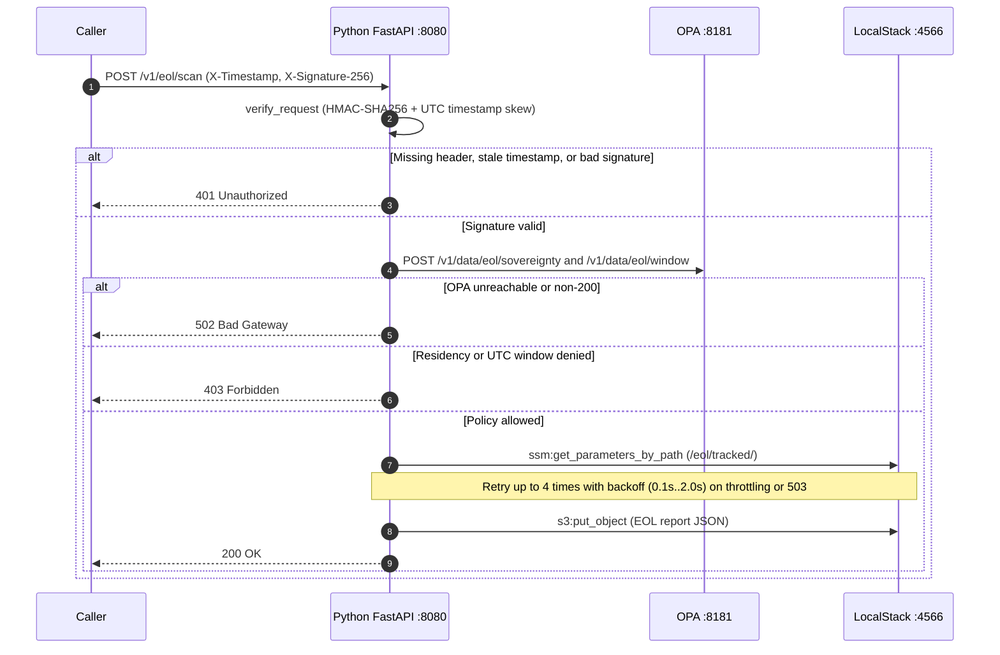
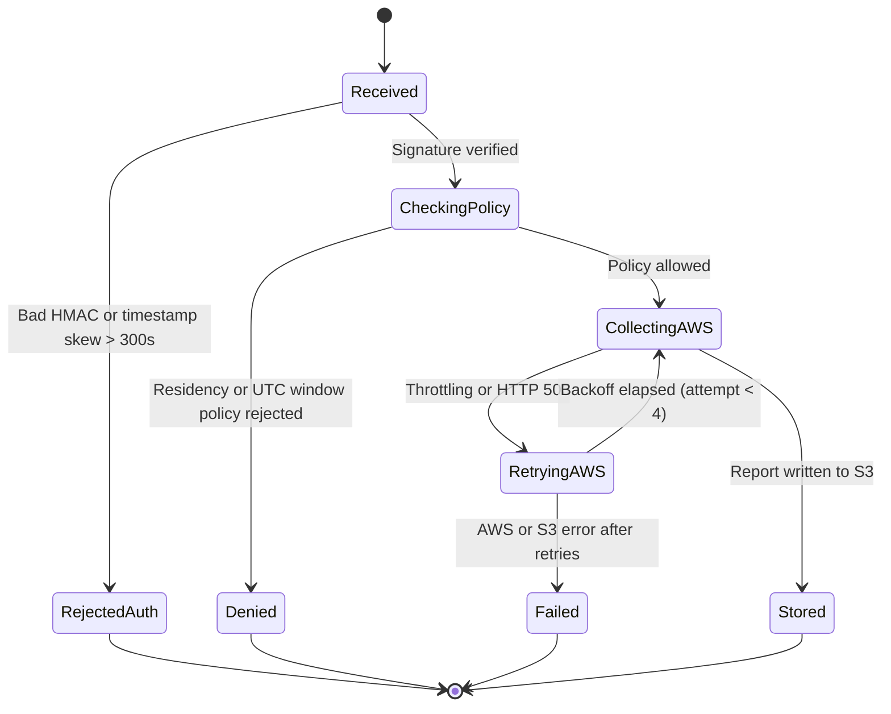

# Design Notes: AWS Cloud Service Deprecation and End-of-Life Tracker

This service checks AWS runtime and version entries stored in SSM Parameter Store (`/eol/tracked/`) against known AWS end-of-life dates, enforces residency and UTC scan window rules in Open Policy Agent (OPA), and writes JSON reports to S3.

## Sequence and Error Handling

## Scan Lifecycle State Machine

## Edge Cases and Limitations

Timestamp verification and scan hours use UTC (`time.time()` and `datetime.now(timezone.utc)`) so Daylight Saving Time changes do not alter window enforcement. When `grace_extension.enabled` is true with `extra_minutes` up to 15 and a reference ID of at least 5 characters, off-window scans are allowed for `platform-ops` or `compliance-lead`. AWS API calls retry throttling and HTTP `429`/`502`/`503`/`504` responses with per-step sleep capped at `2.0s`.

Current limitations: `AWS_EOL_REFERENCE` in `internal/awseol/collector.py` holds a static dictionary of sample runtimes rather than fetching live AWS service lifecycle feeds, and `get_parameters_by_path` reads the first page of parameters without `NextToken` pagination.
