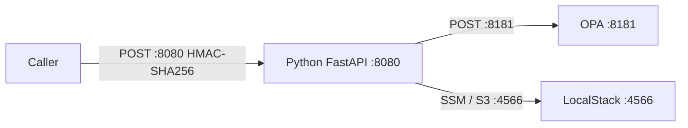

# aws-eol-deprecation-tracker

Python (`3.11+`) FastAPI service that reads tracked runtime entries from AWS SSM Parameter Store (`/eol/tracked/`), checks them against reference end-of-life dates, enforces residency and UTC scan window policies in Open Policy Agent (OPA), and uploads JSON reports to S3.

## System Topology



## Layout

```text
aws-eol-deprecation-tracker/
├── src/eol_tracker/      # FastAPI /healthz and /v1/eol/scan server
├── internal/
│   ├── webhook/          # HMAC-SHA256 and UTC replay check
│   ├── policy/           # OPA REST client for residency and scan window
│   └── awseol/           # boto3 SSM/S3 collector, EOL check, and backoff retry
├── policies/             # OPA Rego files (sovereignty.rego, scan_window.rego)
├── deploy/               # Dockerfile and docker-compose.yml (LocalStack + OPA)
├── tests/                # Unit and benchmark tests
├── DESIGN.md             # Sequence diagram, state diagram, and trade-offs
├── Makefile              # Targets: up, down, run, test, bench, lint
└── pyproject.toml        # Python dependencies
```

## Prerequisites

- Python 3.11+
- Docker and Docker Compose
- `curl` and `openssl`

## Local Setup and Usage

Start LocalStack (`ssm`, `s3`) and OPA:

```bash
make up
```

Run the API server:

```bash
make run
```

Check health:

```bash
curl -s http://localhost:8080/healthz
```

Send a signed scan request:

```bash
BODY='{"role":"platform-ops","residency":"general","region":"us-east-1"}'
TS=$(date -u +%s)
SIG="sha256=$(printf '%s.%s' "$TS" "$BODY" | openssl dgst -sha256 -hmac 'local-dev-eol-secret' | awk '{print $2}')"

curl -s -X POST http://localhost:8080/v1/eol/scan   -H "Content-Type: application/json"   -H "X-Timestamp: $TS"   -H "X-Signature-256: $SIG"   -d "$BODY"
```

Run tests and benchmark:

```bash
make test
make bench
```

Stop containers:

```bash
make down
```

## Known Limitations

- Static runtime lifecycle dictionary (`AWS_EOL_REFERENCE`) in `internal/awseol/collector.py`.
- Single AWS region per process (`AWS_REGION`).
- SSM `get_parameters_by_path` does not loop over `NextToken` for large parameter trees.
